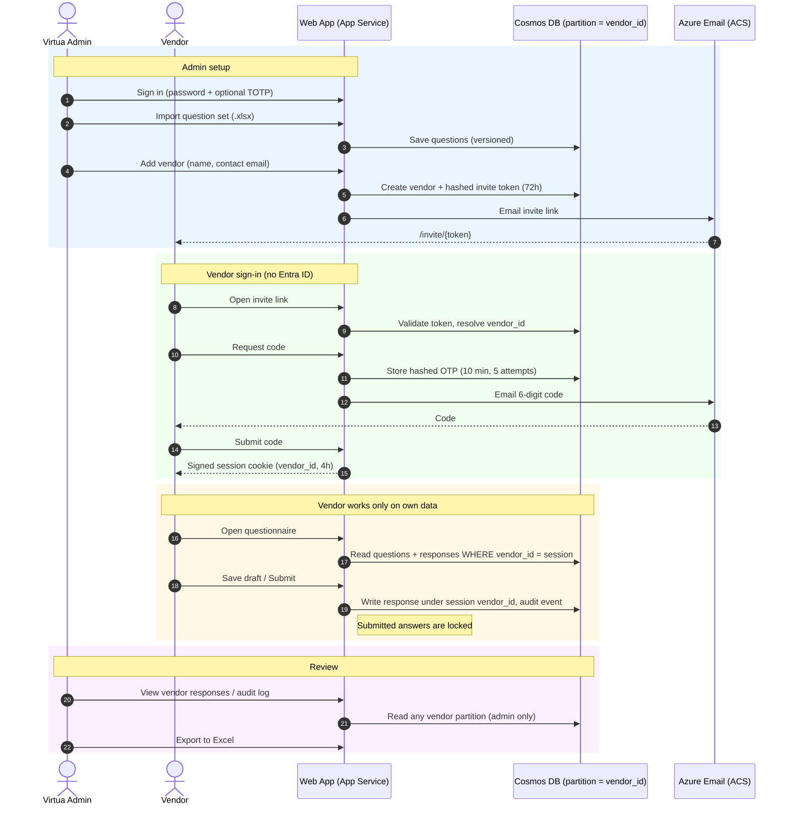

# Vendor IT Questionnaire (Contoso Health)

Web app replacing the Excel security/governance questionnaire. No Entra ID / external IdP.

## How access works
- **Vendors**: admin creates a vendor (name + contact email) → app emails a single-use-style invite link (valid 72h) → vendor requests a 6-digit email OTP (10 min, 5 attempts, 60s resend throttle) → signed, HttpOnly, SameSite=Strict session cookie (4h) holding the `vendor_id`.
- **Isolation**: the vendor identity comes *only* from the signed session; no vendor id is ever accepted from a URL/form. Cosmos DB partition key is `/vendor_id` and every vendor-facing repo call is scoped to it. Covered by `tests/test_isolation.py`.
- **Admin (Contoso staff)**: local password (PBKDF2 hash) + optional TOTP, with lockout. Secrets live in Key Vault.
- Other controls: CSRF tokens, security headers, upload type/size limits, audit log, submitted responses are locked.

## Admin workflow
1. Sign in at `/admin/login`.
2. Import the question set from Excel (`Section | Question | Type[text|yesno|longtext]`, header row first). A ready-to-use example is [`samples/sample-questionnaire.xlsx`](samples/sample-questionnaire.xlsx) (21 questions across 7 sections); regenerate or edit it via `python samples/generate_sample.py`.
3. Add vendors (invite emailed + shown once). Review answers, export to Excel, view audit log.

## Run locally (in-memory store, emails logged to `mailer.outbox`)
```powershell
cd vendor-questionnaire
pip install -r requirements.txt
python -c "from app.security import hash_password; print(hash_password('YourAdminPassword'))"
$env:ADMIN_PASSWORD_HASH = '<output>'
uvicorn app.main:app --reload
pytest
```

## Deploy
```powershell
az deployment group create -g <rg> -f infra/main.bicep -p prefix=vq sessionSecret=<random> adminPasswordHash='<hash>'
cd vendor-questionnaire; Compress-Archive -Path app,requirements.txt -DestinationPath app.zip
az webapp deploy -g <rg> -n <app> --src-path app.zip --type zip
```
Set `BASE_URL` app setting to the site URL (used in invite links). Verify the ACS email domain per your sender requirements.

## Test mode (no email needed)
Set the app setting `DEBUG_SHOW_OTP=true`: the verify page then displays the one-time code (and any email error) directly, and the admin page always shows the invite link. **Turn it off (`false`) before real vendors use the app** – it bypasses the email-ownership check.

## Interaction flow



Vendor identity is taken only from the signed session, never from a URL or form field, so a vendor can't reach another vendor's partition or the admin pages.

## Notes
- Evidence file upload is not included yet; questionnaire answers are text-based.
- Optionally restrict `/admin` by IP (App Service access restrictions) or front with Front Door/WAF.
